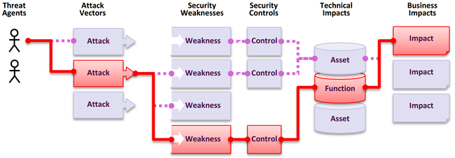

# Secure SDLC and AppSec program

[← AppSec](./README.md)

> **Progression:** concept → advanced → apply.

How to run **application security as a program** — not a one-off scan before release. Risk catalog: [2](./2_OWASP_Top_10_2025_In_Practice.md). Threat-model workshops: [Threat-Modeling](../Threat-Modeling/README.md). CI gate *mechanics*: [DevOps-Handbook Security](https://github.com/thisiskushal31/DevOps-Handbook/tree/main/Security).

An application security risk is a path: a threat agent chooses an attack vector, hits a weakness, defeats or bypasses a control, damages a function or asset, and produces business impact. Your program’s job is to shorten that path and make remaining residual risk explicit.



*Credit: OWASP Top 10:2025 (application security risk diagram).*

```text
Threat agent → Attack vector → Weakness
                    ↓
              Security control (works / fails / missing)
                    ↓
              Technical impact (asset / function)
                    ↓
              Business impact
```

## Concept

### What “secure SDLC” means here

Security activities belong **inside** the same lifecycle the team already uses — requirements, design, implementation, verification, operations — not in a parallel “security sprint” that can be cancelled. If security is optional side work, busy teams will skip it.

| Lifecycle moment | AppSec habit | Failure if missing |
|------------------|--------------|--------------------|
| **Requirements** | AuthZ rules, data class, abuse cases; keep a living security-requirements set | Features ship without deny-by-default rules |
| **Design** | Threat model new trust boundaries; secure-by-default choices | “We’ll harden later” becomes never |
| **Implementation** | Proactive controls in code (access control, validation, crypto, logging) | Every sprint reintroduces Top 10 themes |
| **Verification** | Review + SAST/DAST/SCA + **authZ** tests; fix before promote | Scanners without triage theater |
| **Operations** | Patch, config hygiene, logging→**alerting**, incident → regression | Same bug class returns next quarter |

### How programs actually fail (before the CVE)

| Anti-pattern | What happens |
|--------------|--------------|
| Security only at release | Design flaws and missing authZ are already baked in |
| “Scanner green” as the gate | A01/A03/A09/A10 under-detected; no owner for findings |
| One person can code → prod | Supply-chain and insider tamper path with no dual control |
| Wiki standards, no CI | Standards exist; nothing blocks non-compliance |
| Logs without alerts | Incidents discovered by customers |
| Patch quarterly only | Known-exploitable windows measured in months |

### Prepare → protect → produce → respond

Four practice groups organize secure software development at program scale. Use them as a checklist against whatever SDLC labels you already have (Agile, DevOps, waterfall hybrids).

| Group | Intent | Concrete practices |
|-------|--------|-------------------|
| **Prepare the organization (PO)** | People, process, tooling ready | Document security requirements for infra *and* products; define roles; train; approved libraries/frameworks; shared requirements so teams do not reinvent policy |
| **Protect the software (PS)** | Stop tampering and unauthorized access to code/artifacts | Least-privilege repos; protect branches; secrets out of git; signed/immutable builds; environment-scoped credentials |
| **Produce well-secured software (PW)** | Design and build with fewer vulns | Risk/threat modeling in design; secure coding; review; SAST/DAST/SCA; authZ and abuse-case tests |
| **Respond to vulnerabilities (RV)** | Find, fix, learn | Ingest CVE/OSV/intel; triage by risk; patch SLA; root-cause; add regression tests so the class does not return |

Anchor practices (names you can put on a program map):

| ID | Practice (short) | Builder habit |
|----|------------------|---------------|
| **PO.1** | Know security requirements at all times | One shared requirements set for org + product; update when law/policy/risk changes |
| **PS.1** | Protect all forms of code | Source, binaries, config-as-code under least privilege |
| **PW.1** | Design for security requirements and risk | Threat model / attack-surface mapping before build; justify any waived requirement |
| **RV.1** | Identify vulnerabilities faster | Monitor public + customer reports; investigate credible issues; shrink attacker window |

```text
PO (ready) ──▶ PS (protect artifacts) ──▶ PW (build secure) ──▶ RV (find/fix/learn)
                     ▲                                              │
                     └──────── incident & intel feedback ───────────┘
```

### Manufacturer posture (secure by design / by default)

If you **ship** software others run, treat product security as a business priority — not a feature bolted on after launch. That means design-time threat modeling, memory-safe defaults where feasible, secure defaults out of the box, automatable updates, and reducing the customer’s constant monitoring/patch burden. Internal AppSec still applies; this framing raises the bar when you are the vendor.

## Advanced

### Maturity without boiling the ocean

A software assurance maturity model gives **measurable** streams (governance, design, implementation, verification, operations) so you improve in iterations:

| Habit | Why |
|-------|-----|
| Score current state honestly | Know which streams are empty |
| Pick 1–2 streams per quarter | Change is slow; depth beats theater |
| Tie scores to tickets and gates | Maturity without delivery is a slide |
| Map streams to PO/PS/PW/RV | Common language with acquisition / audit |

Use the model as a **dashboard**, then deepen technical controls in notes 2–7 — do not turn this folder into a second maturity encyclopedia.

### Positive build patterns (proactive controls)

Risk lists say what goes wrong. Proactive controls say what to **build first**. Headline map below; implementation depth + WSTG testing literacy: [7](./7_Proactive_Controls_And_Testing_Literacy.md).

| # | Control | Stops (examples) |
|---|---------|------------------|
| **C1** | Implement access control | IDOR, missing authZ, force browsing |
| **C2** | Use cryptography to protect data | Cleartext secrets, weak crypto |
| **C3** | Validate all input and handle exceptions | Injection inputs; A10-style fail-open |
| **C4** | Address security from the start | Bolted-on controls after launch |
| **C5** | Secure-by-default configurations | Debug left on; open admin |
| **C6** | Keep components secure | Unmaintained / vulnerable deps (A03) |
| **C7** | Secure digital identities | Weak authn/session (A07) |
| **C8** | Leverage browser security features | Missing headers / cookie flags |
| **C9** | Implement security logging and monitoring | Blind ops (A09) |
| **C10** | Stop server-side request forgery | SSRF (now under A01) |

### Verification stack (what “verify” means)

| Layer | Purpose | Limit |
|-------|---------|-------|
| **Secure code review** | AuthZ, crypto, error paths humans spot | Throughput |
| **SAST** | Injection, secrets, bad patterns in code | False positives; misses design |
| **SCA** | Known component vulns / licenses | Misses novel supply-chain worms until signatures exist |
| **DAST / API tests** | Runtime behavior, authZ bypass | Needs auth context |
| **AuthZ / IDOR suites** | Object- and function-level checks | Must be written — scanners under-cover A01 |
| **Fault / error-path tests** | Fail-closed behavior (A10) | Rarely default in frameworks |

Wire the ordered gate chain in the pipeline repo ([DevOps-Handbook Security](https://github.com/thisiskushal31/DevOps-Handbook/tree/main/Security)); this note owns *why* those gates exist.

### Where gates live (ownership split)

| Concern | Owner in this handbook set |
|---------|----------------------------|
| Why AppSec exists; risk catalog; coding patterns | **This folder** |
| Ordered PR→prod AST gates, tool wiring | DevOps-Handbook `Security/` |
| Who the caller is (OAuth/OIDC/SAML) | [Identity](../Identity/README.md) |
| Crypto misuse details | [Cryptography](../Cryptography/README.md) |
| KEV/EPSS prioritization after findings | [Vulnerability-Management](../Vulnerability-Management/README.md) |
| Packets, firewalls, VPC fabric | [Networks-Deep-Dive](https://github.com/thisiskushal31/Networks-Deep-Dive) |

```text
Design (threat model / PW.1)
  → Code (proactive controls)
    → Verify (review + SAST/DAST/SCA + authZ + error-path)
      → Gate (CI — Handbook)
        → Operate (patch, alert, learn / RV)
```

### Minimum program artifacts

| Artifact | Purpose |
|----------|---------|
| Security / coding standard | What “done” means for engineers |
| Living security-requirements set (PO.1) | Shared once; reused across teams |
| Threat-model record for material changes | Trust boundaries before build |
| Dual-control promote rule | No solo path from commit to production |
| Test plan covering Top 10 themes | Especially A01 and A05 |
| SBOM + dependency policy | A03 / C6 |
| Logging → alerting runbook | A09 — logs without alerts ≈ zero |
| Incident → regression path | Every serious bug becomes a test |

### Separation of duties (supply-chain hygiene in the program)

No single person should be able to write code **and** promote it all the way to production without oversight. Harden repos, developer workstations, CI/CD, artifact stores, and IaC the same way you harden the app — MFA, least privilege, branch protection, signed immutable builds, staged rollouts. Detail when we reach A03 in [2](./2_OWASP_Top_10_2025_In_Practice.md) and Cloud-Security supply chain.

### Top 10 ≠ coding / testing standard

Official Top 10:2025 guidance: the list is an **awareness** document — a starting place, not a complete program or verifiable coding standard. Several risks (notably **A06 Insecure Design**, and “logging + alerting actually works in prod”) are not fully tool-testable. Prefer **ASVS** ([6](./6_ASVS_Verification_Practice.md)) when you need requirements you can implement and evidence.

| Use case | Top 10:2025 | ASVS |
|----------|-------------|------|
| Awareness / entry training | Yes | Comprehensive training |
| Coding / peer-review / unit & integration tests | Bare minimum | **Yes** |
| Design / architecture | Occasionally | **Yes** |
| Penetration testing / tool claims | Bare minimum | **Yes** |
| “We cover 100% of the Top 10” (vendors) | **Discouraged** — not true for tools | Acceptable target language |

### Modern program habits (official Top 10:2025 program chapter)

| Habit | Practice |
|-------|----------|
| Portfolio risk | Rate apps/APIs; put assurance level in CMDB-class inventory |
| Baseline | Policies + **reusable** controls + role-targeted training |
| SDLC embed | Threat model, secure design/review, coding/review, test, remediate — on **every** new initiative |
| Champions / education | Security champion or awareness track; Juice Shop / WebGoat for hands-on vulns |
| Metrics | Introduced vs mitigated vulns, coverage, defect density — fund from data |
| Developer enablement | Give **and teach** SAST, SCA, **secret**, and **IaC** scanners |
| Guardrails + paved roads | Technical defaults so the easiest path is the secure path; IDE security plugins |
| Secrets | Provide a secret manager + docs — not “paste into `.env` forever” |
| Continuous test | Abuse cases + DAST/fuzz in a safe place; time to fix SLAs |
| Operate | Inventory, patch SLAs, logging→alerting, supply-chain hardening, periodic hardening + PT by assurance need |
| Retire | Archive needed data; wipe the rest; delete unused roles; mark CMDB retired |

Mature programs can self-assess with **SAMM** or **DSOMM** — use them as option menus, not unaffordable perfection checklists.

## Apply

1. Draw your real SDLC stages; mark where security happens today (honest gaps).  
2. Map PO / PS / PW / RV to named owners; put PO.1 requirements in a real doc teams use.  
3. Pick three weak proactive controls; open tickets with acceptance tests.  
4. Write a release gate: “No prod without …” (authZ tests + SCA + …).  
5. Confirm dual-control promote exists (or document residual risk).  
6. Confirm CI ownership lives in the pipeline repo — not only in a wiki.  
7. Schedule a threat model for the next new public API ([Threat-Modeling](../Threat-Modeling/README.md)).  
8. Add one alert rule for repeated authZ failures (A09 bridge).  
9. Replace any “Top 10 coding standard” language with ASVS level + in-scope chapters.  
10. Confirm developers have SAST + SCA + secret scan + a paved-road authZ library.

### Self-check

- [ ] Narrate agent → vector → weakness → control → impact  
- [ ] Place security inside SDLC phases, not beside them  
- [ ] Name PO / PS / PW / RV and at least PO.1, PS.1, PW.1, RV.1  
- [ ] List proactive controls C1–C10 at headline level  
- [ ] Explain why scanner-only gates fail A01/A03/A09/A10  
- [ ] Separate AppSec content ownership from CI gate wiring  
- [ ] State dual-control promote as a supply-chain control  
- [ ] Explain why Top 10 is awareness and ASVS is the verifiable standard  
- [ ] Name paved roads / guardrails / developer scanner quartet (SAST, SCA, secrets, IaC)  

## Next

- [OWASP Top 10:2025 in practice](./2_OWASP_Top_10_2025_In_Practice.md)

## Further reading

- [NIST SP 800-218 — Secure Software Development Framework (SSDF) 1.1](https://csrc.nist.gov/pubs/sp/800/218/final)
- [CISA — Secure by Design](https://www.cisa.gov/securebydesign)
- [OWASP SAMM](https://owaspsamm.org/model/)
- [OWASP Top 10:2025 — Establishing a Modern Application Security Program](https://owasp.org/Top10/2025/0x03_2025-Establishing_a_Modern_Application_Security_Program/)
- [OWASP Top 10 Proactive Controls 2024](https://top10proactive.owasp.org/the-top-10/)
- [OWASP Developer Guide — Secure development](https://devguide.owasp.org/en/02-foundations/02-secure-development/)
- [OWASP Top 10:2025](https://owasp.org/Top10/2025/)
- [ASVS](https://asvs.owasp.org/)
- [DevOps-Handbook — Security gate chain](https://github.com/thisiskushal31/DevOps-Handbook/blob/main/Security/4_Security_Gate_Chain.md)
