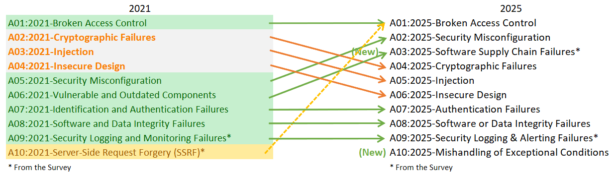

# OWASP Top 10:2025 in practice

[← AppSec (application security)](./README.md)

> **Progression:** concept → advanced → apply.

How the **2025** risk catalog is structured, how it changed from 2021, and how each category fails end-to-end — so you can assign controls and tests. Program spine: [1](./1_Secure_SDLC_And_AppSec_Program.md). Access control, injection, and APIs deepen in notes 3–5.

The Top 10 is an **awareness and prioritization** document — categories of related weaknesses (often many CWEs each), not a ten-line exam list. Eight categories are data-informed; community survey elevates risks that testing data under-represents (notably supply chain and logging/alerting). Roughly **248 CWEs** sit inside the ten categories in this edition.

## Concept

### The 2025 list

| ID | Category | Builder first response |
|----|----------|------------------------|
| **A01** | Broken Access Control | Deny by default; object- and function-level authZ on the **server**; test IDOR (Insecure Direct Object Reference) |
| **A02** | Security Misconfiguration | Hardened defaults; no debug in prod; config as code + review |
| **A03** | Software Supply Chain Failures | Pin/sign deps; protect build; SBOM (Software Bill of Materials); dual-control promote |
| **A04** | Cryptographic Failures | Managed crypto; TLS (Transport Layer Security); no homemade ciphers ([Cryptography](../Cryptography/README.md)) |
| **A05** | Injection | Keep data out of interpreters; parameterize; contextual encode |
| **A06** | Insecure Design | Threat model; abuse cases; secure design before code |
| **A07** | Authentication Failures | MFA (multi-factor authentication); secure session; prefer battle-tested IdP (identity provider) stacks ([Identity](../Identity/README.md)) |
| **A08** | Software or Data Integrity Failures | Verify artifacts; protect CI; signed updates; safe deserialize |
| **A09** | Security Logging and Alerting Failures | Log security events **and** alert; name an owner |
| **A10** | Mishandling of Exceptional Conditions | Fail closed; safe errors; handle abnormal states at the source |

### What changed vs 2021

Read the map left→right before you update training decks still stuck on 2021 IDs:



*Credit: OWASP Top 10:2025 Introduction (2021→2025 mappings).*

| Change | Meaning for your program |
|--------|---------------------------|
| **A01 stays #1**; **SSRF (Server-Side Request Forgery) folded into A01** | Access control dominates; SSRF is reachability/confused-deputy, not a lonely tenth item |
| **Misconfiguration → #2** | Config-driven apps fail open more; treat config like code |
| **A03 Supply Chain Failures** | Expanded beyond “outdated libs”: deps, build, distribution; **50%** of survey respondents ranked it #1 |
| **Injection → #5** | Still 100% tested in contrib data; XSS (Cross-Site Scripting) high frequency, SQLi (SQL injection) high impact |
| **A07 renamed** Authentication Failures | Frameworks helped rates; auth is not “solved” |
| **A09 stresses alerting** | Logs without alerts rarely stop incidents |
| **A10 Exceptional Conditions (new)** | Fail-open, bad error handling, logic under abnormal states |

```text
2021 A10 SSRF ──(rolled into)──▶ 2025 A01 Broken Access Control
2021 A06 Vulnerable Components ─▶ 2025 A03 Software Supply Chain Failures (expanded)
2025 A10 Mishandling Exceptional Conditions ◀── new
```

### Data signals worth remembering

| Signal | Implication |
|--------|-------------|
| **A01**: ~100% of apps tested showed some broken access control | AuthZ tests are mandatory, not optional polish |
| **A03**: few related CVEs, high incidence when tested; highest avg exploit/impact character | Scanners alone under-represent supply chain — program + SBOM + CI hardening |
| **A05**: largest CVE (Common Vulnerabilities and Exposures) pile (XSS tens of thousands; SQLi still severe) | Do not underfund injection defenses because the *rank* dropped |
| Root-cause categories preferred over pure symptoms | Fix “missing authZ” / “misconfig,” not only “data exposure” labels |

## Advanced

### A01 — Broken Access Control (how it happens)

Access control must run in **trusted server-side (or serverless) code** the attacker cannot rewrite. Failures typically mean disclosure, modification, destruction, or business functions outside the user’s limits.

**Common failure shapes:**

| Shape | What the attacker does |
|-------|------------------------|
| Deny-by-default missing | Capabilities open to “anyone authenticated” or anyone at all |
| Parameter / force browsing | Change URL, HTML, or API body to hit another object or admin route |
| IDOR | Swap `acct` / `orderId` / UUID belonging to someone else |
| Missing verb authZ | `GET` checked; `PUT`/`DELETE` open |
| Privilege elevation | Act unauthenticated, or become admin via token/cookie/hidden-field tamper |
| JWT (JSON Web Token) / metadata abuse | Replay, algorithm confusion, or broken invalidation |
| CORS misconfig | Browser calls from untrusted origins succeed |
| Front-end-only authZ | UI hides admin; `curl` still works |

**Prevention (builder checklist):**

| Control | Practice |
|---------|----------|
| Deny by default | Except truly public resources |
| One reusable authZ mechanism | Including tight CORS |
| Enforce **ownership** in the domain model | Not “any ID the client sends” |
| Business limits in domain rules | Quotas, state transitions |
| No directory listing / no `.git` in web root | |
| Log + alert repeated authZ failures | Bridges A09 |
| Rate-limit APIs/controllers | Slows automated abuse |
| Invalidate sessions on logout; short-lived JWTs | Refresh + revoke patterns for long sessions |
| Declarative toolkit patterns | Prefer established authZ libraries |

**Scenario anatomies (authorized education):**

1. **IDOR via query param** — account lookup uses client-supplied `acct` without ownership check → attacker reads `?acct=notmyacct`.  
2. **Force browse** — `/admin_getappInfo` reachable without admin (or without login).  
3. **UI-only gate** — JavaScript hides admin; direct HTTP client still retrieves it.

```text
Client sends object id / admin URL
  → Server MUST check: authenticated? authorized for THIS object/action?
       │
       ├── no → 403 + log (+ alert if repeated)
       └── yes → proceed
Never: “UI hid the button” ⇒ allowed
```

Deepen patterns and API BOLA (Broken Object Level Authorization)/BFLA (Broken Function Level Authorization) in notes 3 and 5.

### A02 — Security Misconfiguration

Cloud buckets public, default credentials, verbose errors, unnecessary services, missing headers, leftover debug. As more behavior moves into config, incidence rises.

**Break it:** hardened baselines; infra-as-code review; secret scanning; disable defaults; prod-safe config parity; treat config changes like code (PR + dual control).

### A03 — Software Supply Chain Failures

Breakdowns in **building, distributing, or updating** software — malicious or vulnerable third-party code, tools, and dependencies. You are likely exposed if you do not track versions (including **transitive** deps), run unmaintained components, lack change tracking across IDE/CI/registries, skip least privilege on the chain, allow one person to ship to prod alone, pull from untrusted sources, or leave CI weaker than the app it builds.

**Prevention spine:**

| Area | Practice |
|------|----------|
| Inventory | Central SBOM; client + server + transitive |
| Reduce surface | Remove unused deps/features |
| Monitor | CVE / NVD / OSV + SCA (Software Composition Analysis) automation; subscribe to alerts |
| Trust | Official sources over TLS; prefer **signed** packages |
| Version policy | Pin deliberately; upgrade when needed, not blindly `latest` |
| Unmaintained libs | Replace, or virtual patch if stuck |
| Tooling | Patch CI/IDE/registries too |
| Rollout | Staged / canary — limit blast if a vendor is compromised |
| Change tracking | CI settings, repos, sandboxes, IDEs, SBOMs, logs, SaaS (Software as a Service) integrations, artifact/container registries |
| Harden | MFA + IAM (Identity and Access Management) on repos, workstations, CI, artifacts, IaC (Infrastructure as Code) |

**Scenario classes:** compromised vendor update (historic SolarWinds-class); conditional malicious vendor behavior; self-propagating package worms that harvest tokens from developer machines; high-impact component RCE (e.g. historical Struts / Log4Shell-class) running at app privilege.

Infra depth: [Cloud-Security/6](../Cloud-Security/6_Supply_Chain_And_Delivery_Integrity.md). Prioritization: [Vulnerability-Management](../Vulnerability-Management/README.md).

### A04 — Cryptographic Failures

Weak algorithms, poor key management, missing TLS, secrets in source, rolling your own crypto → sensitive data exposure or compromise.

**Break it:** platform TLS; vetted libraries; KMS (Key Management Service)/HSM (Hardware Security Module); never invent ciphers. Detail: [Cryptography](../Cryptography/README.md).

### A05 — Injection (how it happens)

Untrusted input reaches an **interpreter** (SQL, OS shell, LDAP, template/EL, browser for XSS) and is executed as command structure. Vulnerable when data is not validated/sanitized, dynamic queries concatenate hostile data, ORM search params are built from raw strings, or commands mix structure and input.

**Prevention preference order:**

1. Safe API / parameterized interface / ORM **without** string-built queries.  
2. Positive server-side validation (incomplete alone when special characters are required).  
3. Context-specific escaping for residual dynamic queries (fragile — last resort).  

**Note:** Even “parameterized” stored procedures can inject if they concatenate inside PL/SQL/`EXECUTE IMMEDIATE`. Table/column names cannot be escaped — never take structure names from users. LLM (large language model) prompt injection is a related class owned by [AI-Security](../AI-Security/README.md).

**Scenario anatomies:**

| # | Pattern | Idea |
|---|---------|------|
| 1 | SQL string concat | `id=' OR '1'='1` changes query meaning |
| 2 | ORM/HQL concat | Same class of bug inside a “safe” framework |
| 3 | OS command concat | `;` / `&&` chains extra commands |

```text
Untrusted input
  → MUST NOT become query/command structure
  → Use bound parameters / safe APIs
  → Encode for OUTPUT context (HTML/JS/URL) separately for XSS
```

Illustrative **vulnerable** shape (do not ship):

```java
// Vulnerable: user input becomes SQL structure
String query = "SELECT * FROM accounts WHERE custID='"
    + request.getParameter("id") + "'";
```

Illustrative **defender** shape:

```java
// Bound parameter — data cannot change SQL structure
PreparedStatement ps = conn.prepareStatement(
    "SELECT * FROM accounts WHERE custID = ?");
ps.setString(1, request.getParameter("id"));
```

Deepen XSS contexts and encoding in note 4.

### A06 — Insecure Design

Missing abuse cases, no threat model, happy-path-only features. Not one missing `if` — the system was never designed to be safe under attack.

**Break it:** threat modeling ([Threat-Modeling](../Threat-Modeling/README.md)); secure design patterns; risk-based requirements before code (PW.1 in [1](./1_Secure_SDLC_And_AppSec_Program.md)).

### A07 — Authentication Failures

Credential stuffing / password spray, weak or fixable sessions, hard-coded credentials, broken certificate host checks, missing MFA where risk demands it, recoverable flows that skip checks.

**Break it:** MFA for sensitive apps; secure session cookies; rate-limit auth; prefer maintained IdP/OIDC (OpenID Connect); never hard-code passwords. Deepen: note 3 + [Identity](../Identity/README.md).

### A08 — Software or Data Integrity Failures

Unsigned updates, weak CI, unsafe deserialization, trusting client-side state. Lower-level trust-boundary failures than full ecosystem A03; overlapping in practice.

**Break it:** sign and verify; protect pipelines; prefer pure-data formats (JSON) over native object deserialize of untrusted input; promote immutable artifacts rather than rebuild per environment. Builder detail on deserialize / uploads: [4](./4_Injection_And_Output_Encoding.md).

### A09 — Security Logging and Alerting Failures

Missing security event logs, no retention, **no alerting**, or alerts with no owner. Great logging with no alert is near-zero incident value.

**Break it:** log authn failures, authZ denials, admin actions; alert on patterns; page someone; test detections. SIEM (Security Information and Event Management): [Defensive-Ops](../Defensive-Ops/README.md).

### A10 — Mishandling of Exceptional Conditions (how it happens)

Three failing modes: the app does not **prevent** an unusual situation, does not **detect** it, and/or **responds** poorly afterward. Causes include weak validation, late/high-level-only handlers, environmental faults (memory, privilege, network), inconsistent or missing catches — leaving the next instruction undefined. Notable themes: sensitive error messages, missing parameters, insufficient privileges mishandled, null derefs, **failing open**.

**Prevention:**

| Control | Practice |
|---------|----------|
| Catch at the source | Handle where the error occurs; meaningful recovery |
| Fail closed | Roll back whole multi-step transactions; do not resume mid-flight |
| User message vs log | Generic client errors; detail in logs; alert when justified |
| Global handler | Backstop for anything missed |
| Rate limits / quotas | Prevent exhaustion and endless brute force |
| Centralize | One consistent error-handling approach per app (ideally org-wide) |
| Observe repeats | Identical errors as stats + original message — do not drown A09 |

**Scenario anatomies:** upload errors that never release resources → DoS; DB errors echoed to users → recon for SQLi; interrupted debit/credit/log without full rollback → drained accounts or double-credit races.

```text
Exception / abnormal state
  → detect at source
  → roll back transaction (fail closed)
  → safe user error + security log (+ alert)
  → never continue privileged flow while state is uncertain
```

### Control-ownership map (release checklist)

| ID | Primary owners | Verify with |
|----|----------------|-------------|
| A01 | AppSec + product | IDOR/BOLA suites; force-browse; SSRF cases |
| A02 | Platform + AppSec | Baseline scans; config PR review |
| A03 | SecEng + DevOps | SCA gate; SBOM; signed artifact + dual-control |
| A04 | AppSec + platform | TLS scan; secret scan |
| A05 | AppSec + developers | SAST (Static Application Security Testing); parameterized-query review; XSS encode tests |
| A06 | Architecture + AppSec | Threat-model record |
| A07 | Identity + AppSec | Authn test plan; MFA; stuffing resistance |
| A08 | DevOps + AppSec | Pipeline hardening; deserialize ban-list |
| A09 | AppSec + SOC (Security Operations Center) | Alert unit tests / detections |
| A10 | Developers + AppSec | Fault-injection; rollback tests |

### How to use the Top 10 without cargo-culting

| Do | Don’t |
|----|-------|
| Map each category to tickets and tests | Memorize only A0x labels for interviews |
| Update training when the year edition changes | Teach 2017/2021 IDs as current truth |
| Prefer root-cause fixes (authZ library, parameterized API) | Assume scanners cover A03/A09/A10 fully |
| Pair with ASVS (Application Security Verification Standard) for “how much is enough” | Treat Top 10 as a complete requirements spec |
| Put SSRF tests under access control | Keep a zombie “A10 = SSRF” checklist |

## Apply

1. Diff internal training / wiki against the **2025** list; fix stale A10=SSRF material.  
2. For each A01–A10, name an owner and one automated or manual test.  
3. Add three IDOR cases (swap object id; force-browse admin; API without UI).  
4. Threat-register one A03 scenario (poisoned dependency, CI credential theft, or worm-class package).  
5. Replace one string-built query with a bound parameter; add a regression test.  
6. Add one fail-closed multi-step rollback test (A10).  
7. Confirm SSRF cases live under A01 testing.  
8. Turn one security log into a paged alert (A09).

### Self-check

- [ ] Recite the 2025 ten with a one-line control each  
- [ ] Explain SSRF→A01 and why A03 ≠ “npm audit once”  
- [ ] Narrate IDOR, UI-only authZ, and SQL-concat injection chains  
- [ ] Distinguish A03 supply chain vs A08 integrity  
- [ ] State A09 alerting and A10 fail-closed / rollback  
- [ ] List prevention preference order for injection  

## Next

- [Access control and authentication](./3_Access_Control_And_Authentication.md) · [Injection and output encoding](./4_Injection_And_Output_Encoding.md)

## Further reading

- [OWASP Top 10:2025](https://owasp.org/Top10/2025/)
- [OWASP Top 10:2025 Introduction](https://owasp.org/Top10/2025/0x00_2025-Introduction/)
- [A01:2025 Broken Access Control](https://owasp.org/Top10/2025/A01_2025-Broken_Access_Control/)
- [A03:2025 Software Supply Chain Failures](https://owasp.org/Top10/2025/A03_2025-Software_Supply_Chain_Failures/)
- [A05:2025 Injection](https://owasp.org/Top10/2025/A05_2025-Injection/)
- [A10:2025 Mishandling of Exceptional Conditions](https://owasp.org/Top10/2025/A10_2025-Mishandling_of_Exceptional_Conditions/)
- [OWASP Top 10 GitHub](https://github.com/OWASP/Top10)
- [Cheat Sheet Series — Index by Top 10](https://cheatsheetseries.owasp.org/IndexTopTen.html)
- [Authorization Cheat Sheet](https://cheatsheetseries.owasp.org/cheatsheets/Authorization_Cheat_Sheet.html)
- [Injection Prevention Cheat Sheet](https://cheatsheetseries.owasp.org/cheatsheets/Injection_Prevention_Cheat_Sheet.html)
- [Error Handling Cheat Sheet](https://cheatsheetseries.owasp.org/cheatsheets/Error_Handling_Cheat_Sheet.html)
