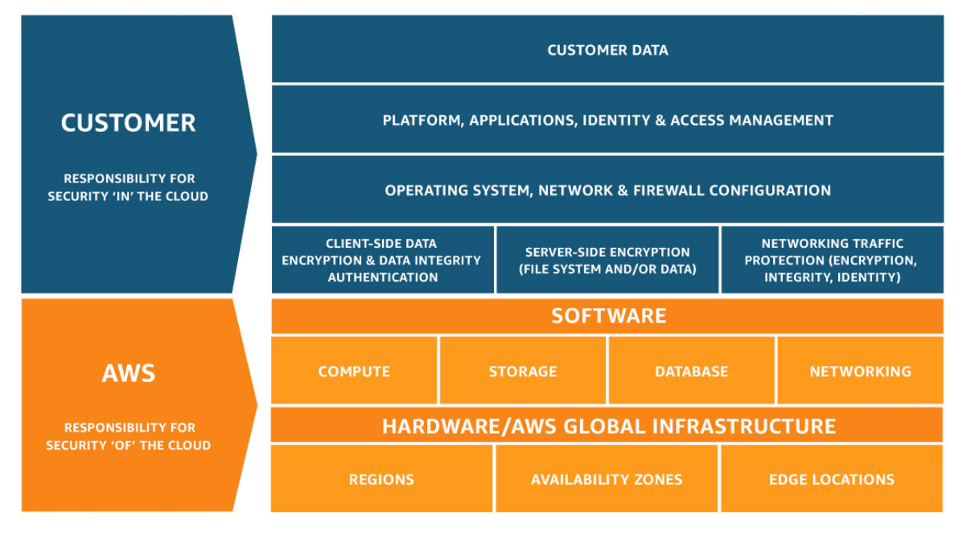
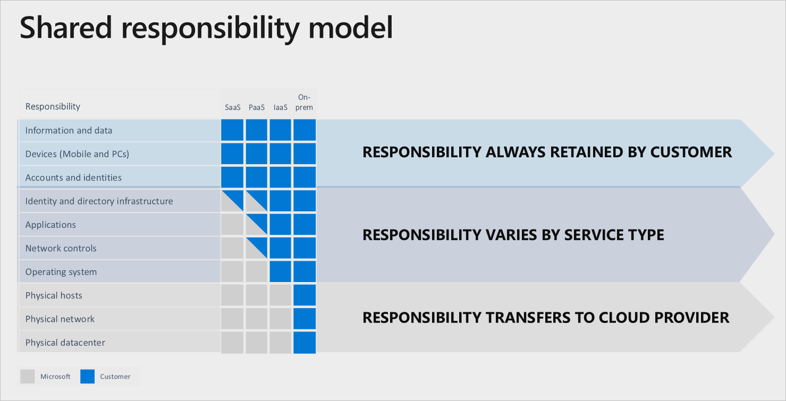

# Cloud models and shared responsibility

[← Cloud-Security](./README.md)

> **Progression:** concept → advanced → apply.

Cloud security starts with **what kind of cloud you are in** and **who owns which controls**. Public, private, community, and hybrid deployments change trust boundaries. IaaS, PaaS, and SaaS change how much stack you configure. Getting those two axes wrong is how teams either over-trust the provider or rebuild a private data center’s worth of controls on a managed database.

Posture tooling: [3](./3_CSPM_And_Posture.md). Identity mechanics: [2](./2_Identity_Network_And_Data_Controls.md) and [Identity](../Identity/README.md). GRC nesting: [GRC](../GRC/README.md).

## Concept

### What “cloud” means (shared vocabulary)

NIST defines cloud computing as on-demand network access to a shared pool of configurable resources that can be rapidly provisioned and released with minimal management effort. Five **essential characteristics**:

| Characteristic | Security implication |
|----------------|----------------------|
| **On-demand self-service** | Humans and automation can create attack surface without a change ticket — guardrails must be programmatic |
| **Broad network access** | Assume APIs and consoles are reachable; harden identity and network paths |
| **Resource pooling** | Multi-tenancy and isolation become first-class risks |
| **Rapid elasticity** | Scale-out can amplify a misconfig (public buckets, open roles) in minutes |
| **Measured service** | Billing and metering data also become forensic and anomaly signals |

Three **service models** (who runs which layer of the stack):

| Model | Consumer typically controls | Provider typically controls |
|-------|----------------------------|-----------------------------|
| **IaaS** | OS, runtime, apps, data, much of network config | Physical, hypervisor, facility |
| **PaaS** | Apps, data, identity, service configuration | OS/runtime/platform under the service |
| **SaaS** | Data, identity, sharing/admin settings | Application + platform + infra |

Four **deployment models** (who the consumers are and where capacity lives):

| Model | Meaning |
|-------|---------|
| **Public** | Infrastructure available to the general public; operated by a provider |
| **Private** | Exclusive use by a single organization (on-site or outsourced) |
| **Community** | Exclusive to several organizations with shared concerns (sector, compliance) |
| **Hybrid** | Composition of two or more distinct clouds bound for portability / bursting |

Deployment model does **not** automatically equal “more secure.” Security level depends on assurances, configuration, identity, and operations — not the label on the slide.

**Provider-neutral rule:** the vocabulary above is from NIST. It applies whether you buy AWS, Azure, GCP, a regional provider, or run a private cloud on your own hardware. Product consoles differ; the security questions do not.

### Managed vs unmanaged (who runs the thing)

| Mode | Meaning | Security focus |
|------|---------|----------------|
| **Unmanaged / you-operate** | You run the guest OS, appliance, or self-hosted stack (classic IaaS VM, self-managed DB on a VM, NGFW appliance, private Kubernetes you built) | Patch, harden, host firewall, agents, backups *you* own |
| **Managed service** | Provider runs the engine (managed DB, object store, queue, load balancer as a service, FaaS) | You still own **identity, network exposure, encryption settings, data, and logging** — the OS patch may move, the blast radius of a public endpoint does not |
| **SaaS** | Provider runs the application | You own tenant admin, SSO, sharing, OAuth apps, data classification |

Most real estates are a **mix**. Securing “the cloud” means applying the right controls for each mode — not pretending managed means “no security work” or unmanaged means “ignore the provider’s shared fabric.”

### Shared responsibility (of vs in the cloud)



*Credit: AWS Well-Architected — Security Pillar (shared responsibility).*

Provider language differs, but the pattern is stable: the provider secures the **cloud**, you secure what you put **in** it — and the split moves with the service model.



*Credit: Microsoft Learn — Shared responsibility in the cloud.*

| You almost always retain | Moves toward the provider as you go IaaS → PaaS → SaaS |
|--------------------------|--------------------------------------------------------|
| Data classification and protection decisions | Physical hosts / network / datacenter |
| Identities and access management for *your* users and apps | Guest OS patching (gone in many PaaS/SaaS) |
| Client devices and endpoints | Large parts of network plumbing |
| Configuration of services you enable | Hypervisor and facility controls |

```text
On-prem:  you own nearly the full stack
IaaS:     provider owns facility + hypervisor; you own OS → data
PaaS:     provider owns OS/runtime; you own app + data + IAM + config
SaaS:     provider owns app stack; you own data + identity + sharing settings
```

## Advanced

### Private cloud is not “automatic trust”

NIST distinguishes **on-site private** vs **outsourced private**:

| Variant | What changes |
|---------|--------------|
| **On-site private** | You (or your ops) control facility and often hypervisor; isolation from the internet is a design choice, not a property of “private” |
| **Outsourced private** | A third party runs dedicated capacity for you; contracts, admin access, and jurisdiction matter as much as technical isolation |

Private clouds still need IAM, patching, logging, segmentation, and supply-chain controls. “We host it ourselves” only moves who can make mistakes — it does not remove multi-tenant *application* risk if you still share clusters across business units.

### Community and hybrid realities

| Model | Security focus |
|-------|----------------|
| **Community** | Shared policies among members; who administers the shared plane; how one member’s compromise affects others |
| **Hybrid** | Identity federation across boundaries; data residency; encrypted interconnects; consistent logging; clear “system of record” for secrets and keys |
| **Multi-cloud** | Multiple public providers (sometimes plus private): duplicated IAM models, inconsistent CSPM coverage, and key sprawl are the usual failures |

Hybrid and multi-cloud fail when teams treat each cloud as a silo with different break-glass stories and no shared incident ownership.

### Multi-tenancy and isolation

Pooling means your neighbor may be another customer (public) or another business unit (private/community). Isolation mechanisms include hypervisor boundaries, VPC/VNet constructs, IAM policy, encryption with separate keys, and (for containers) namespace + network policy. Assume **defense in depth**: one control failing should not equal full tenant compromise.

### Scope-of-control mistakes

| Mistake | Why it hurts |
|---------|--------------|
| Treating SaaS as “provider owns security” | Sharing links, OAuth grants, and admin roles are still yours |
| Treating IaaS as “same as colo without extra process” | APIs make destructive changes instant and globally scoped |
| Ignoring jurisdiction / data location | Private or public, legal access paths differ by region and contract |
| No exit / portability plan | Lock-in becomes a resilience and IR problem when you cannot rebuild elsewhere |

AppSec still owns application defects inside whatever model you pick: [AppSec](../AppSec/README.md).

## Apply

### Decision checklist (before building)

1. Name the **deployment** model(s): public / private (on-site or outsourced) / community / hybrid.  
2. Name the **service** model mix per workload (most estates are mixed).  
3. Draw a responsibility matrix: data, identity, keys, network, OS, app, physical.  
4. Mark controls that are **customer-owned** and assign owners.  
5. For hybrid/multi-cloud: one identity strategy, one logging strategy, one IR runbook that names which CSP tickets to open.  
6. For private cloud: verify isolation assumptions with the same rigor you would apply to a public tenant boundary.  
7. Put contractual assurances (SOC reports, shared responsibility docs, data processing terms) next to technical controls — not instead of them.  

```text
Workload
  ├─ deployment: public | private | community | hybrid
  ├─ service:    IaaS | PaaS | SaaS | mix
  ├─ data class + residency
  ├─ identity plane (who issues tokens?)
  └─ customer-owned controls → owners → evidence
```

### Self-check

- [ ] Recite five NIST essential characteristics and one security implication each  
- [ ] Contrast IaaS vs PaaS vs SaaS customer duties  
- [ ] Define public, private, community, hybrid without using vendor product names  
- [ ] Explain on-site vs outsourced private  
- [ ] List three responsibilities you retain in SaaS  
- [ ] Explain why “private” ≠ “secure by default”  
- [ ] Contrast managed vs unmanaged security duties with one example each  
- [ ] State why the same model language works across providers  

## Next

- [Identity, network, firewalls, and data controls](./2_Identity_Network_And_Data_Controls.md)

## Further reading

- [NIST SP 800-145 — Definition of Cloud Computing](https://csrc.nist.gov/pubs/sp/800/145/final)
- [NIST SP 800-146 — Cloud Computing Synopsis and Recommendations](https://csrc.nist.gov/pubs/sp/800/146/final)
- [NIST SP 800-144 — Security and Privacy in Public Cloud Computing](https://csrc.nist.gov/pubs/sp/800/144/final)
- [CSA Security Guidance for Critical Areas of Focus](https://cloudsecurityalliance.org/research/guidance/)
- [AWS Well-Architected — Shared responsibility](https://docs.aws.amazon.com/wellarchitected/latest/security-pillar/shared-responsibility.html)
- [Microsoft Learn — Shared responsibility in the cloud](https://learn.microsoft.com/en-us/azure/security/fundamentals/shared-responsibility)
- [Google Cloud — Shared responsibilities and shared fate](https://cloud.google.com/docs/security/shared-responsibility)
