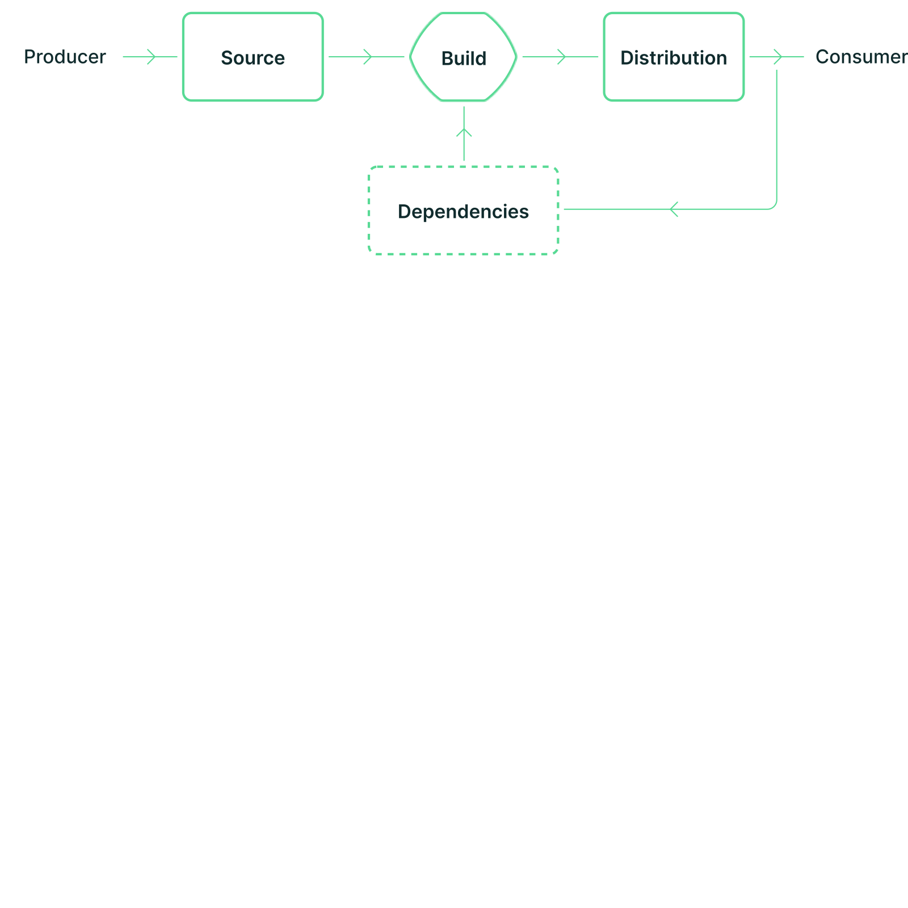
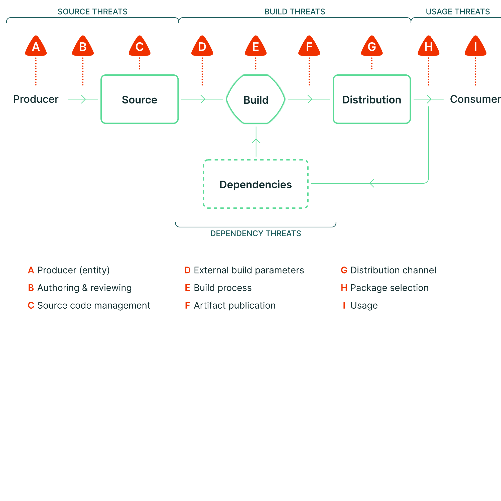

# Supply chain and delivery integrity

[← Cloud-Security](./README.md)

> **Progression:** concept → advanced → apply.

You inherit risk from **dependencies, base images, build systems, registries, and vendors** — whether you deploy to a public cloud, a private cloud registry, or a hybrid promote path. Program controls answer three questions: what did we ship, who built it, and can we refuse tampered artifacts? App-layer catalog: [AppSec A03 / A08](../AppSec/2_OWASP_Top_10_2025_In_Practice.md). Gate wiring and Cosign/Trivy how-tos: [DevOps-Handbook Security](https://github.com/thisiskushal31/DevOps-Handbook/tree/main/Security) and [CiCd supply chain](https://github.com/thisiskushal31/DevOps-Handbook/blob/main/CiCd/6_Supply_Chain_And_Signing.md).

## Concept

### The delivery chain is the trust boundary



*Credit: SLSA — supply chain model (producer → source → build → distribution → consumer; dependencies feed build).*

Software does not jump from a laptop to production in one hop. Each stage can be honest or hostile. Integrity means protection against **tampering or unauthorized modification** along that path; availability means you can still rebuild and investigate later.


*Credit: OWASP Top 10:2025 — A03 Software Supply Chain Failures icon.*

A03 elevated supply chain beyond “outdated libraries”: build systems, distribution, developer tooling, and change control. A08 covers **integrity** failures — unsigned updates, unverified artifacts, unsafe deserialize, CI (continuous integration) that can be rewritten silently.


*Credit: OWASP Top 10:2025 — A08 Software or Data Integrity Failures icon.*

### Control map (what each control is for)

| Control | Job |
|---------|-----|
| **Lockfiles / pins / digests** | Reproducible inputs; no floating `latest` |
| **SCA (Software Composition Analysis)** | Known vulnerabilities in packages you already chose |
| **SBOM (Software Bill of Materials)** | Inventory of what is inside the artifact |
| **VEX (Vulnerability Exploitability eXchange)** | Whether a CVE in a component is actually exploitable *in your product* |
| **Sign / attest** | Cryptographic proof of who produced what |
| **SLSA (Supply-chain Levels for Software Artifacts)-oriented builders** | Hardened, hosted builds with trustworthy provenance |
| **Trusted promotion** | Promote the same artifact; do not rebuild per environment |
| **Admission verify** | Cluster/runtime rejects unsigned or unexpected provenance |
| **Dual-control promote** | No single person writes code and ships prod alone |

```text
deps + source ──▶ CI build ──▶ artifact + SBOM + provenance
                                      │
                              sign / attest
                                      │
                         registry / package repo
                                      │
                    verify at deploy / admission / runtime
```

## Advanced

### Threats along the chain (A–I literacy)



*Credit: SLSA — supply chain threats overview (labels A–I).*

| Label | Stage | Example failure |
|-------|-------|-----------------|
| **A** | Producer | Compromised maintainer / insider pushes against intent |
| **B** | Authoring & review | Malicious or unauthorized change past weak review |
| **C** | Source control | Compromised git host or branch protections bypassed |
| **D** | External build parameters | Build invoked with attacker-controlled inputs |
| **E** | Build process | Compromised CI / build platform injects behavior |
| **F** | Artifact publication | Upload that does not match the trusted build |
| **G** | Distribution channel | Poisoned registry, mirror, or CDN path |
| **H–I** | Package selection / usage | Wrong package chosen; consumer runs a tampered artifact |
| *(deps)* | Dependency threats | Compromised transitive package (recursive A–I on upstream) |

Famous shapes to keep in training (not a how-to): build-platform implants, stolen package-publish credentials, dependency worms that abuse developer tokens, and “update” channels that deliver malware under a trusted vendor name.

### SBOM — inventory, not a silver bullet

An SBOM is a **nested inventory** of components. It enables SCA, license review, and incident blast-radius (“are we on Log4j?”). It does **not** by itself prove the binary is untampered — that is signing and provenance.

| Practice | Why |
|----------|-----|
| Generate SBOM in CI for every release artifact | Same pipeline that produces the binary |
| Prefer standard formats (CycloneDX / SPDX) | Tooling interoperability |
| Track **transitive** deps, not only direct | Most CVEs hide one level down |
| Pair with VEX where you assert “not affected” | Stops endless false-urgent tickets |
| Store SBOM with the artifact | IR and customers can consume later |

NTIA/CISA minimum-element guidance defines the baseline fields programs expect; treat “we have a JSON file somewhere” as incomplete if it is not tied to the shipped digest.

### SLSA (Supply-chain Levels for Software Artifacts) Build track (intent)

| Level | Intent |
|-------|--------|
| **Build L0** | No guarantees |
| **Build L1** | Provenance **exists** (documents how it was built; forgeable) |
| **Build L2** | **Signed** provenance from a **hosted** build platform |
| **Build L3** | **Hardened** build platform (isolation; signing keys unavailable to build steps) |

Climb levels deliberately: L1 helps prevent honest mistakes; L2/L3 raise the cost of tampering during or after the build. Ecosystem details evolve — verify against the current SLSA spec when you set contractual levels.

### Signing, provenance, and CI trust

| Practice | Why |
|----------|-----|
| Sign container images / packages (Cosign-class) | Verifiers can refuse unknowns |
| Attestations (provenance, SBOM attach) | Bind claims to digests |
| OIDC from CI to cloud/registry | No long-lived push keys in CI secrets when avoidable |
| Separate **build** identity from **deploy** identity | Stolen deploy creds should not rewrite the builder |
| Immutable artifacts; promote, don’t rebuild | “Prod build” that differs from “staging build” hides drift |
| Protect branch + required reviews on release paths | Source integrity before fancy attestations |

Sigstore-style transparency (public or private transparency logs) is literacy for “how verification scales,” not a mandate to paste install commands here.

### Harden the pipeline like production

A03 calls out CI/CD that is **weaker than the systems it deploys**. Treat runners, webhook secrets, cache poison paths, and artifact repos as high-value assets. Change management should cover CI settings, registries, SBOM tooling, and IDE extensions — not only application repos.

## Apply

### Ordered gates (program view)

1. Pin dependencies and base-image digests.  
2. SCA on lockfiles / images in PR and on main.  
3. Emit SBOM for the release artifact; store next to the digest.  
4. Build on a hosted, controlled runner — not a laptop for production artifacts.  
5. Sign the artifact; attach provenance.  
6. Promote the **same** digest through environments.  
7. Verify signature/provenance at deploy or admission.  
8. Dual-control for production promote.  
9. Monitor vendor and ecosystem advisories for anything in the trust path.  
10. On CI secret compromise, treat as **production incident fuel** — rotate and review publish history.

Handbook gate chain: [Security/4](https://github.com/thisiskushal31/DevOps-Handbook/blob/main/Security/4_Security_Gate_Chain.md).

```text
PR: pin + SCA + secret scan + IaC
        │
        ▼
 main build: SBOM + tests + image build
        │
        ▼
   sign + attest + push digest
        │
        ▼
 staging verify ──▶ prod verify (admission)
        │
        ▼
 runtime: drift / vuln program (Vulnerability-Management)
```

### Scenario anatomies (authorized education)

1. **Floating tag** — `image: app:latest` pulls a different digest overnight; prod is not what was tested.  
2. **Stolen publish token** — attacker uploads malware under your package name; consumers without verify install it.  
3. **CI poison** — compromised workflow injects a dependency during build; artifact looks “official.”  
4. **SBOM without verify** — inventory says “clean last week”; today’s unsigned replacement is still accepted.

### Private registry and hybrid promote

| Context | Extra duty |
|---------|------------|
| Private-cloud registry | Same sign/verify rules; protect registry admin like a cloud root |
| Hybrid promote | Promote the **same digest** across on-prem and public; do not “rebuild for the other cloud” silently |
| Air-gapped | Plan how provenance and SBOM travel with the artifact offline |

### Self-check

- [ ] Draw producer → source → build → distribution → consumer and name one threat per stage  
- [ ] Separate SBOM (inventory) from signing (integrity)  
- [ ] State Build L1 vs L2 vs L3 in one sentence each  
- [ ] Explain promote-same-digest vs rebuild-per-env  
- [ ] Map A03 and A08 to at least two delivery controls each  
- [ ] Name dual-control promote as a supply-chain control  
- [ ] Explain why weak CI is in scope for A03  

## Next

- [Logging, detection, and cloud IR](./7_Logging_Detection_And_Cloud_IR.md)

## Related

- Threat vectors: [Threats/2](../Threats/2_Vectors_And_Surfaces.md)  
- SSDF / program: [AppSec/1](../AppSec/1_Secure_SDLC_And_AppSec_Program.md)  
- SBOM in vuln workflow: [Vulnerability-Management](../Vulnerability-Management/README.md)

## Further reading

- [OWASP Top 10:2025 A03 Software Supply Chain Failures](https://owasp.org/Top10/2025/A03_2025-Software_Supply_Chain_Failures/)
- [OWASP Top 10:2025 A08 Software or Data Integrity Failures](https://owasp.org/Top10/2025/A08_2025-Software_or_Data_Integrity_Failures/)
- [NIST SP 800-218 — SSDF](https://csrc.nist.gov/pubs/sp/800/218/final)
- [NIST SP 800-204D — Supply Chain Security in DevSecOps CI/CD](https://csrc.nist.gov/pubs/sp/800/204/d/final)
- [CISA — SBOM](https://www.cisa.gov/sbom)
- [NTIA — Software Bill of Materials](https://www.ntia.gov/page/software-bill-materials)
- [SLSA](https://slsa.dev/)
- [SLSA — Supply chain threats](https://slsa.dev/spec/v1.1/threats-overview)
- [Sigstore](https://www.sigstore.dev/)
- [CycloneDX](https://cyclonedx.org/)
- [SPDX](https://spdx.dev/)
- [in-toto](https://in-toto.io/)
- [OWASP Software Supply Chain Security Cheat Sheet](https://cheatsheetseries.owasp.org/cheatsheets/Software_Supply_Chain_Security_Cheat_Sheet.html)
- [OWASP CI/CD Security Cheat Sheet](https://cheatsheetseries.owasp.org/cheatsheets/CI_CD_Security_Cheat_Sheet.html)
- [OpenSSF Scorecard](https://securityscorecards.dev/)
- [DevOps-Handbook — Supply chain and signing](https://github.com/thisiskushal31/DevOps-Handbook/blob/main/CiCd/6_Supply_Chain_And_Signing.md)
